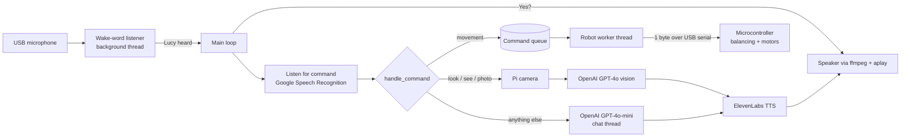

# Self-Balancing Robot with Voice and Vision

A two-wheeled self-balancing robot you control by voice. A Raspberry Pi runs **Lucy**, a voice assistant that:

- wakes up when you say **"Lucy"**
- turns spoken commands ("balance", "go forward", "turn left", "stop", …) into single-byte commands sent over USB serial to the microcontroller that runs the balancing loop
- takes a photo with the Pi camera and **describes what it sees** using OpenAI vision
- answers any other question with OpenAI chat
- speaks every reply out loud in a natural voice using ElevenLabs text-to-speech

The microcontroller (Arduino-compatible board on a CH340 USB-serial chip) keeps the robot upright. The Pi handles everything that needs intelligence: listening, understanding, seeing, talking, and deciding where to go.

---

## Table of contents

1. [How it works](#how-it-works)
2. [Hardware](#hardware)
3. [Project structure](#project-structure)
4. [Voice commands](#voice-commands)
5. [Serial protocol](#serial-protocol)
6. [Code walkthrough](#code-walkthrough)
7. [Threads and concurrency](#threads-and-concurrency)
8. [Setup](#setup)
9. [Configuration](#configuration)
10. [Troubleshooting](#troubleshooting)
11. [Known limitations and ideas](#known-limitations-and-ideas)

---

## How it works



1. **Wake word.** A background listener streams audio from the microphone and sends each phrase to Google Speech Recognition. When the text contains `lucy`, it sets a wake event.
2. **Command capture.** The main loop wakes up, says "Yes?", and records one phrase (up to 6 seconds, waiting up to 5 seconds for you to start talking).
3. **Dispatch.** `handle_command` matches keywords in what you said:
   - movement words → a command is queued for the robot
   - vision words → the camera takes a photo, OpenAI describes it, and Lucy reads the description out loud
   - anything else → OpenAI answers on a separate thread, so the robot stays responsive
4. **Speech output.** Replies are synthesized by ElevenLabs as MP3, converted to 48 kHz WAV with `ffmpeg`, and played with `aplay`. While Lucy is talking, the microphone ignores input so she doesn't react to her own voice.

---

## Hardware

| Part | Role |
|------|------|
| Raspberry Pi (4 / 5 recommended) | Runs Lucy (this repository) |
| Arduino-compatible board with CH340 USB-serial | Runs the balancing (PID) firmware and drives the motors |
| IMU (e.g. MPU6050) | Tilt sensing for balancing, connected to the microcontroller |
| Motor driver + 2 DC/stepper motors | Wheels |
| Raspberry Pi camera module | Vision |
| USB microphone | Voice input |
| Speaker (3.5 mm / USB / HAT) | Voice output |
| Battery pack(s) | Power for the motors and the Pi |

The Pi and the microcontroller are connected by a single USB cable, which carries both power and serial data.

> The balancing firmware is not included in this repository. It only needs to accept the single-byte commands listed under [Serial protocol](#serial-protocol).

---

## Project structure

```
.
├── main.py              Entry point: startup, main loop, clean shutdown
├── lucy/
│   ├── __init__.py
│   ├── config.py        Settings, serial command map, .env loading, validation
│   ├── robot.py         Serial connection + background command queue
│   ├── speech.py        Text-to-speech, speech recognition, wake-word listener
│   ├── ai.py            OpenAI chat and image description
│   ├── camera.py        Raspberry Pi camera capture
│   └── commands.py      Maps spoken phrases to robot / vision / chat actions
├── requirements.txt     Python dependencies
├── .env.example         Template for API keys, voice ID and serial port
└── .gitignore
```

Each module has one job, so you can swap out a piece (for example a different TTS provider) without touching the rest.

---

## Voice commands

Say **"Lucy"**, wait for **"Yes?"**, then say one of:

| You say | What happens | Serial byte |
|---------|--------------|-------------|
| "**stop**" | Robot stops | `s` |
| "**balance**" | Robot starts balancing | `5` |
| "**move forward**" / "**go forward**" | Drives forward | `f` |
| "**move back**" / "**go back**" | Drives backward | `b` |
| "**turn left**" | Turns left | `l` |
| "**turn right**" | Turns right | `i` |
| "**see**" / "**look**" / "**photo**" / "**picture**" | Takes a photo and describes it | – |
| *anything else* | Answered by OpenAI chat | – |

"Stop" is always checked first. A sentence such as *"stop balancing"* therefore stops the robot instead of starting it.

---

## Serial protocol

| Setting | Value |
|---------|-------|
| Port | `SERIAL_PORT` from `.env` |
| Baud rate | 9600 (configurable) |
| Format | One ASCII byte per command, no newline |

| Command | Byte |
|---------|------|
| BALANCE | `5` |
| FORWARD | `f` |
| BACK | `b` |
| LEFT | `l` |
| RIGHT | `i` |
| STOP | `s` |

The mapping lives in `SERIAL_COMMANDS` in [`lucy/config.py`](lucy/config.py). Change it there if your firmware uses different bytes.

---

## Code walkthrough

### `main.py` — entry point

| Function | Description |
|----------|-------------|
| `main()` | Sets up logging, validates the configuration (`require_config`), opens the serial link (`Robot()`), announces "Lucy is online.", and starts the wake-word listener. It then loops forever: wait for the wake event → say "Yes?" → `listen_blocking()` → `handle_command()`. On **Ctrl+C** it stops the listener, sends STOP to the robot, closes the serial port and says "Goodbye." |

### `lucy/config.py` — settings

| Name | Description |
|------|-------------|
| `load_dotenv()` | Runs on import and loads variables from `.env` into the environment. |
| `WAKE_WORD`, `VOICE_ID`, `TTS_MODEL`, `CHAT_MODEL`, `VISION_MODEL` | Assistant settings: wake word, ElevenLabs voice, and which models to use (`eleven_turbo_v2_5`, `gpt-4o-mini`, `gpt-4o`). |
| `SERIAL_PORT`, `BAUDRATE` | Serial connection settings from `.env`. |
| `SERIAL_COMMANDS` | Dictionary mapping command names (`"FORWARD"`) to the byte sent to the firmware (`b"f"`). |
| `CAPTURE_SIZE`, `CAPTURE_PATH` | Photo resolution (1280×720) and output file. |
| `require_config()` | Checks that `OPENAI_API_KEY`, `ELEVENLABS_API_KEY`, `ELEVENLABS_VOICE_ID` and `SERIAL_PORT` are set. If any are missing, it raises an error that names them, before any hardware is touched. |
| `setup_logging()` | Sets the log format to `time \| thread \| level \| message`, so you can see which thread did what. |

### `lucy/robot.py` — talking to the microcontroller

`class Robot` wraps the serial port and a command queue.

| Method | Description |
|--------|-------------|
| `__init__(port, baudrate)` | Opens the serial port with a 1 s timeout, then waits 2 s because most Arduino boards reset when the port opens. Exits cleanly if the port can't be opened. Starts the background `RobotThread`. |
| `send(cmd)` | Puts a command name (e.g. `"LEFT"`) on the queue and returns immediately, so the voice loop never blocks on serial I/O. |
| `_worker()` | Runs on the background thread. Takes commands off the queue one at a time, looks up the byte in `SERIAL_COMMANDS`, writes it to the port, and logs the result. Unknown commands and serial errors are logged instead of crashing the program. |
| `close()` | Sends STOP to the robot as a safety measure, then closes the port. Called on shutdown. |

### `lucy/speech.py` — hearing and speaking

| Name | Description |
|------|-------------|
| `audio_lock` | A `threading.Lock` held while audio is converted and played. Listeners check it and ignore input while Lucy is talking, which stops her from hearing herself. It also stops two replies from playing over each other. |
| `recognizer` | Shared `speech_recognition.Recognizer` with energy threshold 400 and dynamic adjustment, so it adapts to background noise such as motor whine. |
| `_tts_client()` | Creates the ElevenLabs client the first time it's needed, then reuses it. |
| `speak(text)` | Sends `text` to ElevenLabs (`text_to_speech.convert`, MP3 44.1 kHz) and writes the audio stream into a **per-call temporary directory**. Then, while holding `audio_lock`, it converts the file to 48 kHz WAV with `ffmpeg` and plays it with `aplay`. Errors are logged, never raised, so a TTS failure can't stop the robot. |
| `listen_blocking(timeout, phrase_limit)` | Opens the microphone, calibrates for 0.4 s of ambient noise, records a single phrase and transcribes it with Google Speech Recognition. Returns lower-case text, or `None` on silence, unclear speech, a network error, or while Lucy is talking. |
| `start_wake_listener(wake_event)` | Calibrates the microphone for 1 s, then starts `recognizer.listen_in_background`. Its callback transcribes each phrase and sets `wake_event` when the wake word appears. Returns the function that stops the listener. |

### `lucy/ai.py` — OpenAI chat and vision

| Function | Description |
|----------|-------------|
| `_openai()` | Creates the OpenAI client the first time it's needed, then reuses it. |
| `chat(text)` | Sends the user's sentence to `gpt-4o-mini` and returns the reply text, or `None` on error. |
| `encode_image(path)` | Reads an image file and returns it base64-encoded. |
| `describe_image(image_path)` | Sends the photo to `gpt-4o` as a `data:image/jpeg;base64,…` URL with the prompt *"Describe what you see in this image."* Returns the description, or a friendly fallback sentence on error. |

### `lucy/camera.py` — taking photos

| Function | Description |
|----------|-------------|
| `capture_image(path)` | Imports `picamera2` only when called, so the rest of the code can be developed on a laptop. Configures a 1280×720 still capture, waits 1 s for auto-exposure to settle, and saves a JPEG. The `finally` block always stops **and closes** the camera, so later captures don't fail with "camera in use". Returns the file path, or `None` on error. |

### `lucy/commands.py` — understanding commands

| Function | Description |
|----------|-------------|
| `handle_command(cmd, robot)` | Keyword-based intent matching on the transcribed text, in priority order: **stop** → balance → forward → back → left → right → vision words → chat. Movement commands say a short confirmation and call `robot.send()`. Vision commands capture, describe and speak. Everything else starts a `ChatThread`. |
| `_chat_and_speak(text)` | Runs on the chat thread: gets a reply from `chat()` and speaks it, or says "I had trouble answering that." on failure. |

---

## Threads and concurrency

| Thread | Started by | Job |
|--------|------------|-----|
| **MainThread** | `main()` | Waits for the wake word, records a command, dispatches it |
| **Wake-word listener** | `start_wake_listener()` | Continuously listens for "Lucy" |
| **RobotThread** | `Robot.__init__()` | Writes queued commands to the serial port in order |
| **ChatThread** (one per question) | `handle_command()` | Calls OpenAI and speaks the answer without blocking the main loop |

Coordination:

- `threading.Event` (`wake_event`) carries the wake-word signal from the listener to the main loop.
- `queue.Queue` lets several threads send robot commands safely, in order.
- `threading.Lock` (`audio_lock`) serializes audio playback and mutes the listeners while Lucy is talking.
- Background threads are daemon threads, so Ctrl+C exits cleanly.

---

## Setup

### 1. System packages (Raspberry Pi OS)

```bash
sudo apt update
sudo apt install python3-picamera2 ffmpeg alsa-utils portaudio19-dev flac
```

- `python3-picamera2` — camera library (installed via apt, not pip)
- `ffmpeg` — MP3 → WAV conversion
- `alsa-utils` — provides `aplay`
- `portaudio19-dev` — needed to build PyAudio (microphone access)
- `flac` — used by SpeechRecognition to encode audio for Google

### 2. Python environment

```bash
git clone https://github.com/DurgaPrasadPuli/Self-Balancing-Robot-with-Voice-and-Vision.git
cd Self-Balancing-Robot-with-Voice-and-Vision

python3 -m venv --system-site-packages venv   # lets the venv see apt's picamera2
source venv/bin/activate
pip install -r requirements.txt
```

### 3. Configure

```bash
cp .env.example .env
nano .env
```

Fill in your API keys, ElevenLabs voice ID and serial port. To find the serial port:

```bash
ls /dev/serial/by-id/
```

### 4. Run

```bash
python main.py
```

You should hear **"Lucy is online."** Say **"Lucy"**, wait for **"Yes?"**, then say **"balance"**.

---

## Configuration

All settings live in `.env`. It is git-ignored, so your keys are never committed.

| Variable | Required | Description |
|----------|:-------:|-------------|
| `OPENAI_API_KEY` | ✅ | OpenAI API key (chat + vision) |
| `ELEVENLABS_API_KEY` | ✅ | ElevenLabs API key (text-to-speech) |
| `ELEVENLABS_VOICE_ID` | ✅ | The ElevenLabs voice Lucy speaks with |
| `SERIAL_PORT` | ✅ | Serial device of the microcontroller. Prefer the `/dev/serial/by-id/...` path, which doesn't change between reboots |
| `BAUDRATE` | | Defaults to `9600`. Must match the firmware |
| `WAKE_WORD` | | Defaults to `lucy` |

---

## Troubleshooting

| Problem | Fix |
|---------|-----|
| `Missing ... in .env` on startup | Copy `.env.example` to `.env` and fill in every required value. |
| `[SERIAL ERROR] could not open port` | Check the USB cable and `SERIAL_PORT`. Add your user to the `dialout` group: `sudo usermod -aG dialout $USER`, then log out and back in. |
| Lucy never hears the wake word | Check the microphone with `arecord -l`. Lower `recognizer.energy_threshold` in `lucy/speech.py` in a quiet room. Speech recognition needs internet access. |
| No sound | Test with `aplay /usr/share/sounds/alsa/Front_Center.wav` and pick the right output in `raspi-config`. |
| `[CAMERA ERROR]` | Check the camera ribbon cable and `rpicam-hello --list-cameras`. Make sure no other program is using the camera. |
| Robot ignores commands | Confirm the baud rate and command bytes match your firmware. Open the Arduino Serial Monitor and send `5` by hand to test. |

---

## Known limitations and ideas

- **Needs internet.** Speech recognition, chat, vision and TTS are all cloud services. Offline options: Vosk / Whisper for speech recognition, Piper for TTS.
- **Keyword matching is simple.** Words are matched as substrings, so "see" also matches "seed". OpenAI function calling could make intent detection more robust.
- **Two microphone streams.** The wake-word listener and the command listener both open the microphone. Some USB mics don't allow that; if yours doesn't, pause the background listener while recording a command.
- **No conversation memory.** Each chat question is sent on its own. Keeping a short message history would allow follow-up questions.
- **Commands are fire-and-forget.** The firmware doesn't send an acknowledgement. Adding one would let Lucy confirm that a move actually happened.
